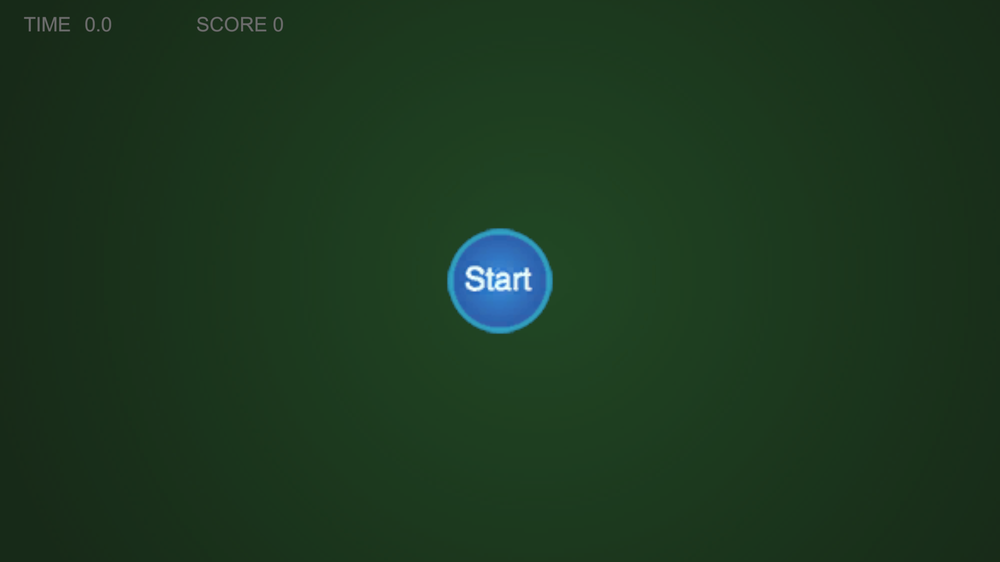
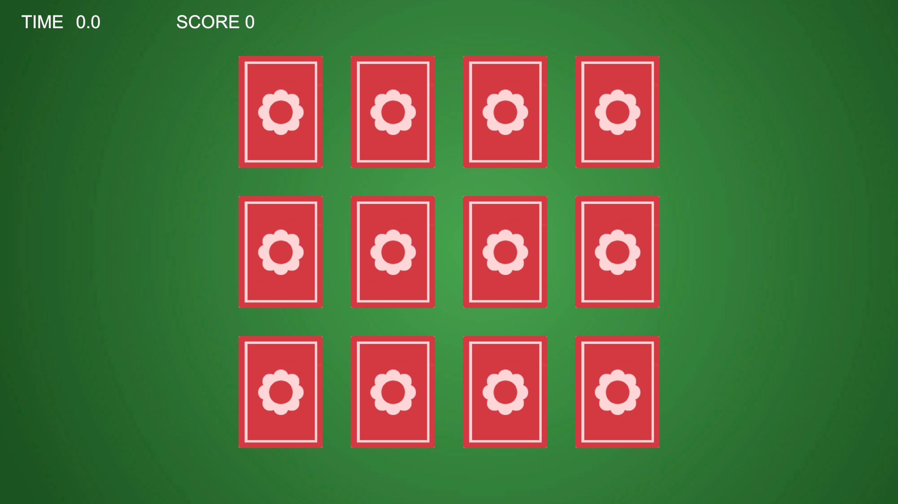
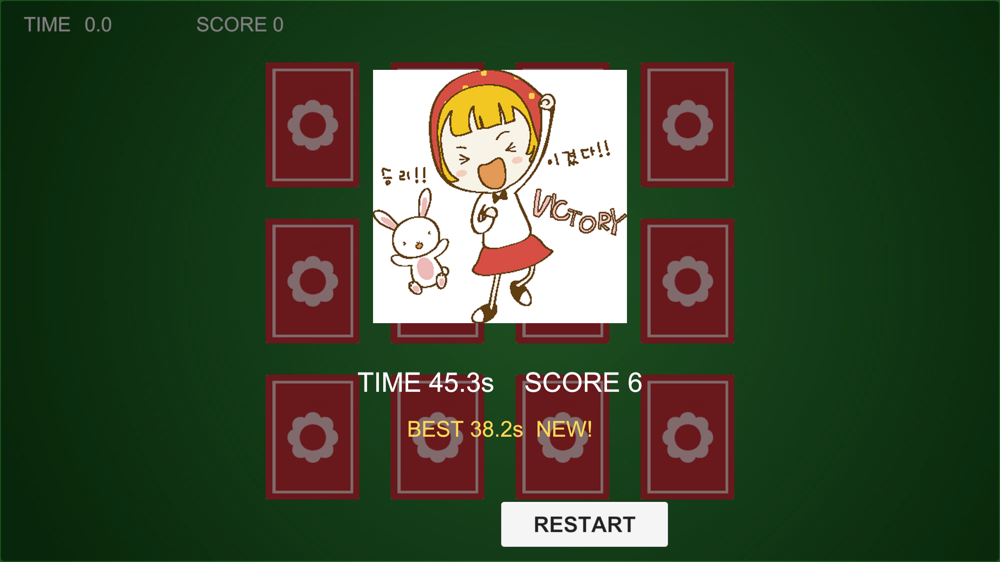

# 实验报告 ——《记忆翻牌》游戏开发实验

| 项目 | 内容 |
|---|---|
| 课程名称 | 游戏开发技术 |
| 实验名称 | 《记忆翻牌》休闲游戏的设计与实现 |
| 姓名 | 李明华 |
| 学号 | 2405480117 |
| 班级 | 24 级数字媒体技术 1 班 |
| 学院 | 滇西科技师范学院 信息学院 |
| 实验日期 | 2026 年 10 月 23 日 |
| 开发环境 | Unity 2022.3.62f3c1 LTS，内置渲染管线，C#，Windows 11 |
| 运行平台 | WebGL（浏览器） |

---

## 一、实验目的

1. 掌握 Unity 2D 场景的搭建方法，理解正交相机、`SpriteRenderer` 与 UGUI 三者的分工与坐标关系；
2. 掌握 C# 数组操作与 Fisher–Yates 洗牌算法，理解"元素值作索引"如何保证牌面成对；
3. 掌握有限状态机思想在卡牌交互状态管理中的应用；
4. 掌握协同程序（Coroutine）实现延时逻辑的方法，以及防连点锁的设计；
5. 完成一个可发布到 WebGL 平台并能在浏览器中直接游玩的完整小游戏。

## 二、实验内容与要求

设计并实现《记忆翻牌》游戏：12 张卡牌按 3 行 4 列排列，牌面共 6 种、每种 2 张。玩家每次翻开两张牌，若牌面相同则保持正面并计分，否则 1.5 秒后翻回背面；全部配对成功后计时停止并弹出结算界面。

**非功能要求**：同时运行于浏览器（WebGL）与 Windows；鼠标操作；无失败态（不计步数、不设倒计时致死）。

## 三、需求分析

| 编号 | 功能 | 说明 |
|---|---|---|
| F1 | 卡牌生成与排布 | 12 张牌按 3 行 4 列排列，位置由公式计算 |
| F2 | 洗牌 | 每局开始随机打乱牌面位置 |
| F3 | 翻牌 | 单击卡牌由背面翻为正面 |
| F4 | 配对判定 | 两张牌 ID 相同即配对成功，否则 1.5 秒后翻回 |
| F5 | 计分与计时 | 每配对成功一对加 1 分，全程计时 |
| F6 | 胜负结算 | 6 对全部配对后停表并弹出胜利面板 |
| F7 | 开始与重开 | Start 开始，Restart 重新洗牌开局 |

## 四、系统设计

### 4.1 模块结构

| 脚本 | 职责 |
|---|---|
| `ShuffleUtil.cs` | 静态工具类，实现 Fisher–Yates 洗牌 |
| `Card.cs` | 单张卡牌的三状态管理与翻面显示（含 UI 穿透守卫） |
| `BoardManager.cs` | 卡牌池（`numbers` 数组）、洗牌、按公式生成 12 张牌 |
| `GameManager.cs` | 主控：计时、点击流程、配对判定、计分、胜负、重开 |
| `UIManager.cs` | 计时/分数刷新、开始与胜利面板、按钮事件 |
| `Sfx.cs` | 程序化音效合成（正弦波 + 包络，运行时生成 AudioClip） |
| `Editor/BuildTools.cs` | 安全构建入口：等待编译/导入/播放模式结束后再构建 |

### 4.2 卡牌状态机

```
        点击
未翻开 ────────► 翻开
（Hidden）        （Revealed）
                  │    │
        配对失败   │    │ 配对成功
      1.5s后翻回   │    ▼
                  │  配对成功（Matched，锁定不可点）
                  └──►（回到 未翻开）
```

状态由枚举 `State { Hidden, Revealed, Matched }` 表示，对外暴露 `IsClickable => state == State.Hidden`，一切点击合法性都由此单一判据决定，避免了分散的布尔标志。

### 4.3 布局算法

以左下角卡片为起始点，设 `originalX = -3`、`originalY = 0`，相邻卡片横向间隔 `offsetX = 2`、纵向间隔 `offsetY = 2.5`，则第 `i` 行第 `j` 列卡片的位置为：

```
(x, y) = (offsetX * j + originalX, offsetY * i + originalY)
```

代入 `i = 2`、`j = 3` 得 `(3, 5)`，即右上角卡片位置；代入 `i = 0`、`j = 0` 得 `(-3, 0)`，即左下角卡片位置。牌阵横向跨度为 `[-3, 3]`、纵向为 `[-1, 6]`，中心在 `(0, 2.5)`，据此把正交相机定位到 `(0, 2.5, -10)`、`Size = 4.5`（可见宽度 16:9 下为 16，4:3 下为 12，均大于所需 7.5），保证 12 张牌完整入镜。

## 五、关键技术与实现

### 5.1 洗牌算法（Fisher–Yates）

```csharp
public static void Shuffle<T>(T[] array)
{
    for (int i = 0; i < array.Length; i++)
    {
        int r = Random.Range(i, array.Length);   // 在 [i, 末尾] 之间取随机数
        T tmp = array[i];                        // 交换 i 与 r
        array[i] = array[r];
        array[r] = tmp;
    }
}
```

将 12 个元素初始化为 `{0,0,1,1,2,2,3,3,4,4,5,5}`，元素值即 `images` 数组的索引，由此保证每种牌面恰好出现 2 张；再对该数组洗牌即可随机化排布。与常见的"取模交换"写法相比，`Random.Range(i, length)` 保证每个排列等概率出现，洗牌无偏。

### 5.2 按公式生成卡牌

```csharp
for (int i = 0; i < rows; i++)
{
    for (int j = 0; j < cols; j++)
    {
        float x = offsetX * j + originalX;   // 布局公式
        float y = offsetY * i + originalY;

        int index = _numbers[i * cols + j];  // numbers → images 的索引

        Card card = Instantiate(cardPrefab, boardRoot);
        card.transform.position = new Vector3(x, y, 0f);
        card.Init(index, images[index], backSprite, cardSortingOrder, onCardClicked);
        _cards.Add(card);
    }
}
```

第 `i` 行第 `j` 列的牌面由 `Images[numbers[i * cols + j]]` 决定。例如第 2 行第 1 列对应索引 `2 * 4 + 1 = 9`，若 `numbers[9] = 5`，则该位置显示 `images[5]`。

> 采用"世界坐标 + `SpriteRenderer` + `BoxCollider2D` + `OnMouseDown`"方案，而非 `GridLayoutGroup`：后者的实际落点由布局组内部计算，与课件给出的坐标公式对不上，也无法在 `Scene` 视图中用 Gizmo 逐个核对坐标。

### 5.3 配对判定与协程延时翻回

```csharp
private IEnumerator CheckMatch()
{
    _isChecking = true;

    if (_firstRevealed.id == _secondRevealed.id)   // ID 相等 → 配对成功
    {
        _firstRevealed.SetMatched();
        _secondRevealed.SetMatched();
        _score++;
        if (ui != null) ui.UpdateScore(_score);
        if (_matchedPairs >= board.PairCount) GameOver();
    }
    else
    {
        yield return new WaitForSeconds(flipBackDelay);  // 暂停 1.5 秒
        _firstRevealed.Hide();
        _secondRevealed.Hide();
    }

    _firstRevealed = null;
    _secondRevealed = null;
    _isChecking = false;
}
```

协同程序让配对失败的牌停留 1.5 秒再翻回，避免瞬间翻回导致玩家看不清牌面；`_isChecking` 作防连点锁，保证这 1.5 秒内点击第三张牌无效。`Restart()` 中先 `StopAllCoroutines()` 并把 `_isChecking` 复位，因而"配对失败瞬间点重开"不会残留待执行的翻回逻辑。

### 5.4 界面穿透守卫

UGUI **不会**自动拦截世界物体的 `OnMouseDown`——UI 射线与物理射线是两套独立机制，点击面板会"穿透"到面板下方的卡牌。解法是面板 `Image` 保留 `Raycast Target`，并在点击回调里主动判断：

```csharp
private void OnMouseDown()
{
    if (state != State.Hidden) return;
    if (EventSystem.current != null)
    {
        bool overUI = Input.touchCount > 0
            ? EventSystem.current.IsPointerOverGameObject(Input.GetTouch(0).fingerId)
            : EventSystem.current.IsPointerOverGameObject();
        if (overUI) return;
    }
    ...
}
```

`touchCount` 分支使手机浏览器打开 WebGL 版时同样不会穿透。

## 六、运行结果

| 截图 | 内容 |
|---|---|
| 图 1 | 游戏开始界面（Start 按钮） |
| 图 2 | 开局牌桌：12 张牌按 3×4 排布，全部为背面 |
| 图 3 | 胜利结算界面（用时 + 得分 + VICTORY 插画） |







**构建结果**（`Tools → Memory Card → Build WebGL (Safe)`，2026-10-23）

| 项目 | 数值 |
|---|---|
| 构建目标 | WebGL（IL2CPP → wasm） |
| 首次全量耗时 | 87.1 s |
| 增量重建耗时 | 46.5 s |
| Unity 统计体积 | 19.96 MB |
| 磁盘实际产物 | 6.27 MB / 17 个文件 |
| 主要产物 | `webgl.wasm.unityweb` 5,051,166 B、`webgl.data.unityweb` 1,406,059 B、`webgl.framework.js.unityweb` 73,476 B、`webgl.loader.js` 44,292 B |
| 压缩方式 | Gzip（文件头 `1f 8b`）+ Decompression Fallback |
| 编译错误 / 控制台报错 | 0 / 0 |

**功能自测**

| 用例 | 期望 | 结果 |
|---|---|---|
| 连点同一张牌 | 只翻一次，不占第二次选择名额 | 通过 |
| 1.5 秒内连点三张不同牌 | 第三张无反应（`_isChecking` 锁） | 通过 |
| 点击已配对牌 | 无反应，分数不变 | 通过 |
| 配对失败瞬间点重开 | 无残留翻回，新局正常洗牌 | 通过 |
| 16:9（1280×720） | 12 张牌完整可见 | 通过 |
| 4:3（1024×768） | 12 张牌完整可见 | 通过 |
| 开始面板显示时点卡牌 | 无反应（UI 穿透守卫生效） | 通过 |
| 全流程通关 | 6 对配对后停表、显示用时与得分 | 通过（实测 24.3 s / 6 分） |

**工程自检**：`Tools → Memory Card → Validate Project` 一次性检查 15 项（缺失脚本、管理器唯一性、14 个序列化引用、`images` 完整度、牌数奇偶、预制体组件、构建场景列表、WebGL 模块、精灵 PPU、相机取景覆盖等），实测 **PASS 15 / 警告 0 / 失败 0**。

## 七、遇到的问题与解决方法

| # | 问题现象 | 原因分析 | 解决方法 |
|---|---|---|---|
| 1 | 卡牌点击无反应 | 相机非正交投影 / 卡牌缺 `Collider2D` / 相机 Z 为正导致射线打不到 | 相机改 Orthographic、Z 设 -10，卡牌加 `BoxCollider2D` |
| 2 | 点击 UI 面板会顺带翻开面板下方的卡牌 | UGUI 不拦截世界物体的 `OnMouseDown`，两套射线互相独立 | 面板 `Image` 保留 `Raycast Target`；`Card.OnMouseDown` 内加 `IsPointerOverGameObject()` 守卫 |
| 3 | 12 张牌不在视野中央 | 牌阵 y 范围为 [-1, 6]，中心在 y = 2.5，而相机默认在原点 | 相机 `Position` 改为 (0, 2.5, -10) |
| 4 | 构建直接失败，日志报 `Error building Player because scripts are compiling` | 构建指令在脚本编译尚未结束、或 Play 模式仍开启时下发 | 新增 `BuildTools.cs`：用 `EditorApplication.delayCall` **非阻塞**轮询 `isCompiling / isUpdating / isPlaying`，全部空闲后才启动构建。不能用 `Thread.Sleep` 阻塞主线程——域重载要靠主线程回到事件循环才能完成 |
| 5 | 两张同号牌瞬间配对后，卡牌被永久锁在背面贴图 | `state` 已置 `Matched`，但翻面协程被 `StopCoroutines` 打断在中途一帧，目标贴图从未提交 | `Card.StopAnimations()` 在停止协程前，若存在未完成的翻面则先写入目标贴图再复位 |
| 6 | 播放中途发生域重载后点 Start 无响应 | `GameManager.Instance` 被置空，而物体实际存活 | 单例改为惰性自愈属性：为空时 `FindObjectOfType` 按需找回 |

## 八、实验总结与心得

本实验把"洗牌—翻牌—判定—结算"这条链路完整走了一遍。最直接的收获是理解了随机性的可控来源：把 `{0,0,1,1,…}` 这组"牌面值"而不是"牌对象"拿去洗，既天然保证成对，又让洗牌算法本身可以独立测试，比在每个格子上随机取牌面要可靠得多。

第二个收获是协同程序。最初用计时变量 + `if (timer > 1.5f)` 手写延时，需要自己维护计时起点、判断先后、处理重开时归零，稍不留神就会出现"翻回两次"或"重开后残留翻回"。换成 `yield return new WaitForSeconds(1.5f)` 后，延时逻辑天然有了生命周期，`StopAllCoroutines()` 一行就能整体撤销。

第三个收获来自状态机。把卡牌压缩成 Hidden / Revealed / Matched 三个状态后，所有"能不能点"的问题都归结为 `state == Hidden` 一个判据，代码里不再出现多层 `if` 嵌套。

问题排查中最有价值的一条是"UGUI 不拦截世界物体点击"：现象很像 UI 没挡住，实际是两套射线系统各走各的。这类"看起来是 A 层的问题、原因在 B 层"的情况，必须靠逐层排除（先确认射线是否命中、再确认命中对象）而不是盲改参数。

不足与改进：当前配色与动效偏朴素；难度固定为 3×4，可扩展为 4×4 并提供难度选择；配对失败时可增加轻微的抖动反馈。此外 WebGL 首包 6.27 MB，若引入资源分包或贴图图集，加载速度还能进一步优化。
